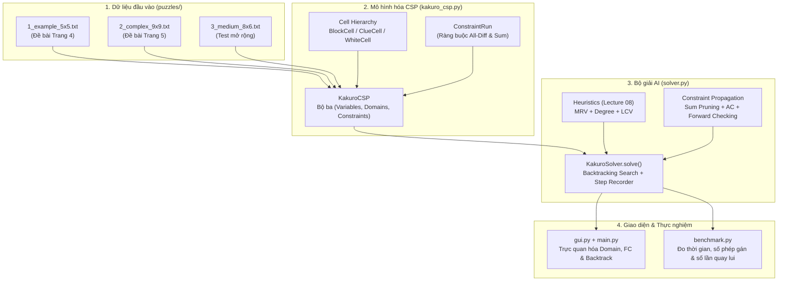

# Giải Thích Chi Tiết Thuật Toán & Mã Nguồn Task 3: Kakuro CSP Solver

Tài liệu này giải thích toàn bộ **cơ sở lý thuyết**, **cách mô hình hóa bài toán**, **các thuật toán tìm kiếm & lan truyền ràng buộc**, cũng như **giải thích chi tiết từng hàm và từng khối code** bên trong thư mục [`task3/`](./).

---

## Tổng Quan Kiến Trúc Dự Án



---

## Phần 1: Mô Hình Hóa Toán Học Bài Toán Kakuro Thành CSP

Một bài toán Thỏa mãn Ràng buộc (**Constraint Satisfaction Problem - CSP**) được định nghĩa bởi bộ ba $\mathcal{P} = \langle X, D, C \rangle$:

| Thành phần CSP | Ký hiệu | Ý nghĩa trong bài toán Kakuro | Biểu diễn trong Code ([`kakuro_csp.py`](kakuro_csp.py)) |
|---|---|---|---|
| **Biến (Variables)** | $X = \{X_1, \dots, X_n\}$ | Mỗi ô trắng cần điền số tại tọa độ $(r, c)$ là một biến $X_{r,c}$. | `self.variables: List[Tuple[int, int]]` |
| **Miền giá trị (Domains)** | $D(X_{r,c})$ | Tập các chữ số nguyên từ $1$ đến $9$ mà ô $(r,c)$ có thể nhận: $D(X_{r,c}) \subseteq \{1, 2, \dots, 9\}$. | `domains: Dict[Tuple[int, int], Set[int]]` |
| **Ràng buộc (Constraints)** | $C$ | Mỗi dải ô trắng liên tiếp (ngang hoặc dọc) có độ dài $k$ và manh mối tổng $S$ phải thỏa mãn:<br/>1. **All-Different**: $\forall i \ne j, X_i \ne X_j$<br/>2. **Exact Sum**: $\sum_{i=1}^k X_i = S$ | Lớp [`ConstraintRun`](kakuro_csp.py) và `self.runs: List[ConstraintRun]` |

---

## Phần 2: Giải Thích Chi Tiết File [`kakuro_csp.py`](kakuro_csp.py)

### 1. Định dạng file bản đồ (`puzzles/*.txt`)

Ví dụ file [`1_example_5x5.txt`](puzzles/1_example_5x5.txt) (bàn cờ mẫu trang 4 của đề bài):

```text
5 5
#      #      21\    14\    #
#      14\12  _      _      11\
\21    _      _      _      _
\11    _      _      _      _
#      \16    _      _      #
```

* **Dòng đầu (`5 5`)**: Số hàng (`rows = 5`) và số cột (`cols = 5`).
* **`#`**: Ô đen đặc không có gợi ý (`BlockCell`).
* **`_`**: Ô trắng cần điền số từ 1 đến 9 (`WhiteCell` — tương ứng với 1 biến CSP).
* **`D\R`**: Ô gợi ý có đường chéo chia đôi (`ClueCell`):
  * **`D` (bên trái dấu `\`)**: Tổng gợi ý theo **chiều dọc xuống dưới (Down clue)** nằm ở tam giác dưới-trái.
  * **`R` (bên phải dấu `\`)**: Tổng gợi ý theo **chiều ngang sang phải (Right clue)** nằm ở tam giác trên-phải.
  * Ví dụ: `21\` là tổng cột = 21; `\16` là tổng hàng = 16; `14\12` là tổng cột = 14 và tổng hàng = 12.

---

### 2. Phân cấp lớp Ô (`Cell`, `BlockCell`, `ClueCell`, `WhiteCell`)

```python
class Cell:
    def __init__(self, row: int, col: int):
        self.row = row
        self.col = col

class BlockCell(Cell):
    pass

class ClueCell(Cell):
    def __init__(self, row: int, col: int, down_clue: Optional[int] = None, right_clue: Optional[int] = None):
        super().__init__(row, col)
        self.down_clue = down_clue
        self.right_clue = right_clue

class WhiteCell(Cell):
    def __init__(self, row: int, col: int):
        super().__init__(row, col)
        self.value: Optional[int] = None
        self.domain: Set[int] = set(range(1, 10))
```

> [!NOTE]
> **Tại sao tách thành 4 lớp kế thừa từ `Cell`?**
> Đề bài yêu cầu thiết kế chuẩn **Hướng Đối Tượng (OOP)**. Việc dùng kế thừa và kiểm tra `isinstance(cell, ClueCell)` / `isinstance(cell, WhiteCell)` giúp mã nguồn rõ ràng, dễ mở rộng và đúng nguyên lý đa hình.

---

### 3. Lớp [`ConstraintRun`](kakuro_csp.py) — Biểu diễn Ràng buộc Dải (Hàng/Cột)

```python
class ConstraintRun:
    def __init__(self, clue_pos: Tuple[int, int], direction: str, target_sum: int, cells: List[Tuple[int, int]]):
        self.clue_pos = clue_pos          # Tọa độ ô Clue gốc
        self.direction = direction        # "horizontal" (ngang) hoặc "vertical" (dọc)
        self.target_sum = target_sum      # Tổng mục tiêu S
        self.cells = cells                # Danh sách các tọa độ ô trắng (r, c) trong dải
        self.length = len(cells)          # Số ô k của dải

        # Tiền xử lý: Tìm tất cả các tập con k chữ số phân biệt từ {1..9} có tổng đúng bằng target_sum
        self.valid_combinations: List[Set[int]] = [
            set(comb)
            for comb in combinations(range(1, 10), self.length)
            if sum(comb) == self.target_sum
        ]
```

**Giải thích kỹ thuật `valid_combinations` (Cắt tỉa theo tổ hợp toán học Kakuro):**
* Sử dụng `itertools.combinations(range(1, 10), self.length)` để sinh các tập con gồm `length` chữ số **khác nhau** từ $1$ đến $9$.
* Chỉ giữ lại những tổ hợp có `sum(comb) == self.target_sum`.
* **Ví dụ:**
  * Nếu dải có `length = 2` và `target_sum = 16`: `combinations(1..9, 2)` có tổng bằng 16 chỉ có duy nhất `[{7, 9}]` (vì $8+8$ bị loại do không lặp số).
  * Phương thức `allowed_digits()` lấy hợp (union) của mọi tổ hợp hợp lệ $\to$ trả về `{7, 9}`. Nhờ đó, các số `{1, 2, 3, 4, 5, 6, 8}` bị loại ngay lập tức!

---

### 4. Lớp [`KakuroCSP`](kakuro_csp.py) — Xây dựng đồ thị ràng buộc và kiểm tra tính nhất quán

1. **`_build_constraints()`**:
   * Quét toàn bộ lưới để tìm các `ClueCell`.
   * Nếu có `right_clue`, đi sang phải (`cc = c + 1, c + 2, ...`) gom tất cả `WhiteCell` liên tiếp để tạo 1 `ConstraintRun` ngang.
   * Nếu có `down_clue`, đi xuống dưới (`rr = r + 1, r + 2, ...`) gom tất cả `WhiteCell` liên tiếp để tạo 1 `ConstraintRun` dọc.
   * Lưu ánh xạ `self.cell_to_runs[pos]`: mỗi ô trắng sẽ thuộc đúng 2 `ConstraintRun` (1 dải ngang và 1 dải dọc).

2. **`_build_domains_and_neighbors()`**:
   * `self.initial_domains[var] = {1..9}`.
   * `self.pruned_domains[var]`: Giao (`&=`) các chữ số hợp lệ của dải ngang và dải dọc đi qua ô `var`:
     $$D_{\text{pruned}}(X_{r,c}) = \text{Allowed}(Run_{\text{row}}) \cap \text{Allowed}(Run_{\text{col}})$$
   * **Ví dụ trên bàn cờ 5x5 (`1_example_5x5.txt`)**:
     * Ô `(4, 2)` nằm ở giao của Hàng 4 (tổng 16 với 2 ô $\to \{7, 9\}$) và Cột 2 (tổng 21 với 4 ô $\to \{1..9\}$). Giao lại: $D(X_{4,2}) = \{7, 9\}$.
     * Ô `(4, 3)` nằm ở giao của Hàng 4 (tổng 16 với 2 ô $\to \{7, 9\}$) và Cột 3 (tổng 14 với 4 ô $\to \{1, 2, 3, 4, 5, 6, 7, 8\}$ vì $1+2+3+9=15 > 14$). Giao lại:
       $$D(X_{4,3}) = \{7, 9\} \cap \{1..8\} = \{7\}$$
       Như vậy, ngay từ bước khởi tạo, ô `(4, 3)` chỉ còn **duy nhất số 7**!
   * `self.neighbors[var]`: Tập hợp mọi ô trắng khác nằm cùng dải ngang hoặc cùng dải dọc với `var`.

3. **`is_consistent(var, val, assignment, domains)`**:
   Kiểm tra xem việc gán `var = val` có hợp lệ với trạng thái gán hiện tại `assignment` không:
   * **Kiểm tra 1 (All-Different):** Nếu `val` đã xuất hiện trong `used_vals` của dải ngang hoặc dải dọc $\to$ `return False`.
   * **Kiểm tra 2 (Đủ dải):** Nếu toàn bộ các ô trong dải đã được gán (`remaining_count == 0`), kiểm tra `remaining_sum == 0`. Nếu lệch tổng $\to$ `return False`.
   * **Kiểm tra 3 (Bounds Check khi dải chưa điền hết):**
     * Lấy danh sách các chữ số từ $1..9$ chưa dùng trong dải (`available`).
     * Tổng nhỏ nhất có thể tạo từ `remaining_count` chữ số nhỏ nhất là `min_possible = sum(available[:remaining_count])`.
     * Tổng lớn nhất có thể tạo từ `remaining_count` chữ số lớn nhất là `max_possible = sum(available[-remaining_count:])`.
     * Nếu `remaining_sum < min_possible` hoặc `remaining_sum > max_possible` $\to$ chắc chắn không thể hoàn thành tổng $\to$ `return False`!
   * **Kiểm tra 4 (Combination Support):** Nếu truyền `domains`, kiểm tra xem có ít nhất một tổ hợp `comb` trong `run.valid_combinations` chứa toàn bộ các số đã gán (`used_vals.issubset(comb)`) và mọi ô chưa gán đều còn ứng viên trong phần còn lại `comb - used_vals` hay không.

---

## Phần 3: Giải Thích Chi Tiết File [`solver.py`](solver.py) — Các Thuật Toán Giải Quyết CSP

File [`solver.py`](solver.py) triển khai 3 cấu hình thuật toán để thực nghiệm đối chiếu:
1. **`Standard BT`**: Backtracking cơ bản (chọn biến tuần tự từ trên xuống dưới, từ trái sang phải; thử giá trị $1 \to 9$; chỉ kiểm tra `is_consistent`).
2. **`BT+FC`**: Backtracking kết hợp **Forward Checking** (lan truyền ràng buộc cắt tỉa miền của các ô láng giềng sau mỗi phép gán).
3. **`BT+FC+Heuristics`**: Kết hợp toàn diện **Sum-Combination Pruning + Arc Consistency + Forward Checking + MRV + Degree Heuristic + LCV**.

---

### 1. Heuristic Chọn Biến: MRV + Degree Heuristic (`select_unassigned_variable`)

```python
    def select_unassigned_variable(
        self,
        assignment: Dict[Tuple[int, int], int],
        domains: Dict[Tuple[int, int], Set[int]],
        use_heuristics: bool = True,
    ) -> Tuple[int, int]:
        unassigned = [v for v in self.csp.variables if v not in assignment]
        if not use_heuristics:
            return unassigned[0]

        def mrv_degree_key(var: Tuple[int, int]) -> Tuple[int, int, Tuple[int, int]]:
            domain_size = len(domains[var])
            degree = sum(1 for nbr in self.csp.neighbors[var] if nbr not in assignment)
            return (domain_size, -degree, var)

        return min(unassigned, key=mrv_degree_key)
```

**Giải thích nguyên lý hoạt động:**
* Hàm `min(unassigned, key=mrv_degree_key)` so sánh các tuple `(domain_size, -degree, var)` theo thứ tự từ điển:
  1. **Tiêu chí 1 — MRV (Minimum Remaining Values):**
     * Chọn biến có `domain_size = len(domains[var])` **nhỏ nhất**.
     * *Tại sao?* Đây là nguyên lý **"Fail-First"** trong Lecture 08: nếu một ô chỉ còn 1 ứng viên (singleton), ta điền ngay không cần đoán; nếu một ô chỉ còn 2 ứng viên, hệ số phân nhánh (branching factor) chỉ là 2 thay vì 9. Nếu nhánh đang đi là sai, việc chọn ô có miền nhỏ nhất sẽ làm lộ mâu thuẫn sớm nhất.
  2. **Tiêu chí 2 — Degree Heuristic (Tie-breaker):**
     * Khi có nhiều biến có cùng `domain_size` nhỏ nhất, Python so sánh phần tử thứ hai là `-degree`.
     * `degree` là số lượng biến láng giềng **chưa được gán** của `var`. Vì có dấu trừ (`-degree`), biến nào có `degree` **lớn nhất** sẽ có `-degree` nhỏ nhất và được chọn!
     * *Tại sao?* Biến có nhiều láng giềng chưa gán nhất sẽ tạo ra sức ép cắt tỉa mạnh nhất lên các ô xung quanh khi chạy Forward Checking.

---

### 2. Heuristic Sắp Xếp Giá Trị: LCV (`order_domain_values`)

```python
    def order_domain_values(
        self,
        var: Tuple[int, int],
        assignment: Dict[Tuple[int, int], int],
        domains: Dict[Tuple[int, int], Set[int]],
        use_heuristics: bool = True,
    ) -> List[int]:
        values = sorted(domains[var])
        if not use_heuristics or len(values) <= 1:
            return values

        def lcv_cost(val: int) -> int:
            eliminated = 0
            for run in self.csp.cell_to_runs[var]:
                used = {val} | {assignment[c] for c in run.cells if c in assignment and c != var}
                allowed_in_run: Set[int] = set()
                for comb in run.valid_combinations:
                    if used.issubset(comb):
                        allowed_in_run.update(comb - used)

                for nbr in run.cells:
                    if nbr != var and nbr not in assignment:
                        for d in domains[nbr]:
                            if d == val or d not in allowed_in_run:
                                eliminated += 1
            return eliminated

        return sorted(values, key=lambda v: (lcv_cost(v), v))
```

**Giải thích nguyên lý hoạt động:**
* **LCV (Least Constraining Value)** đi theo nguyên lý **"Succeed-First"**:
  * Khi đã chọn được biến `var`, ta cần quyết định thử giá trị `val` nào trước.
  * Hàm `lcv_cost(val)` đếm số lượng giá trị `d` trong miền của các biến láng giềng chưa gán (`nbr`) sẽ bị **loại bỏ** nếu ta gán `var = val` (bao gồm giá trị trùng `d == val` hoặc giá trị `d` không còn nằm trong bất kỳ tổ hợp tổng hợp lệ nào `d not in allowed_in_run`).
  * Ta sắp xếp tăng dần theo `lcv_cost(val)`: giá trị nào làm mất **ít lựa chọn của hàng xóm nhất** sẽ được ưu tiên thử trước, giúp chừa lại không gian linh hoạt tối đa cho các ô còn lại.

---

### 3. Lan Truyền Ràng Buộc: Forward Checking & Combination Propagation (`forward_check`)

Sau khi gán `assignment[var] = val`, thay vì đợi đến lúc điền kín cả hàng/cột mới kiểm tra tổng, `forward_check()` lập tức cắt tỉa miền giá trị của các ô chưa gán:

1. **Chế độ cơ bản (`full_propagation=False` dùng trong `BT+FC`)**:
   * Duyệt qua dải ngang và dải dọc chứa `var`.
   * Với mỗi ô chưa gán `u` trong dải, loại bỏ mọi giá trị `d` nếu:
     * `d` trùng với giá trị đã gán trong dải (`d in used_vals`).
     * Chỉ còn 1 ô trống cuối cùng trong dải mà `d != rem_sum`.
     * Hoặc `d + min_others > rem_sum` / `d + max_others < rem_sum` (vượt ngưỡng tổng cho phép).
   * Mọi giá trị bị xóa đều được ghi vào `pruned_log.append((u, d))`.
   * **Phát hiện ngõ cụt sớm:** Nếu `not domains[u]` (miền của `u` bị rỗng $\emptyset$), lập tức trả về `False` để quay lui ngay!

2. **Chế độ lan truyền tổ hợp đầy đủ (`full_propagation=True` dùng trong `BT+FC+Heuristics`)**:
   * Duyệt hàng đợi `run_queue` bắt đầu từ 2 dải chứa `var`.
   * Tìm các ô đơn trị (`singleton_vals`: những ô chưa gán nhưng miền chỉ còn đúng 1 số khả dĩ).
   * Lọc các tổ hợp `comb` trong `run.valid_combinations` chứa toàn bộ `required_vals = assigned_vals | singleton_vals`.
   * Cắt tỉa mọi số không thuộc `supported_digits` khỏi miền của các ô chưa gán trong dải.
   * **Lan truyền dây chuyền (Cascading Propagation):** Khi miền của một ô `u` bị thu hẹp, dải giao cắt vuông góc với `u` (`other_run`) được đẩy vào `run_queue` để tiếp tục lan truyền sự thu hẹp sang nhánh bên kia!

3. **Cơ chế Khôi phục Miền giá trị khi Quay lui (Domain Restoration):**
   ```python
   # Nếu nhánh tìm kiếm thất bại, khôi phục chính xác những giá trị đã cắt tỉa:
   for cell_pos, removed_val in pruned_log:
       domains[cell_pos].add(removed_val)
   ```
   > [!TIP]
   > Thay vì dùng `copy.deepcopy(domains)` ở mỗi bước đệ quy (tốn rất nhiều bộ nhớ và thời gian $O(N)$ mỗi nút), việc lưu danh sách các cặp `(cell_pos, removed_val)` trong `pruned_log` giúp khôi phục trạng thái miền giá trị trong thời gian $O(1)$ cho mỗi phần tử bị cắt, giữ cho tốc độ giải dưới $5\text{ ms}$!

---

## Phần 4: Giải Thích Giao Diện Trực Quan Hóa [`gui.py`](gui.py)

Đề bài yêu cầu phần UI (1.0 điểm) phải trực quan hóa rõ **3 yếu tố**:
1. **Miền giá trị của các biến (Domains of variables):**
   * Trong hàm `draw_board()`, mỗi ô trắng chưa được gán sẽ được chia thành một lưới con $3 \times 3$ tương ứng với các số từ $1$ đến $9$.
   * Nếu chữ số $d \in D(X_{r,c})$, nó được vẽ rõ bằng màu xanh dương (`DOMAIN_DIGIT_COLOR`).
   * Nếu chữ số $d$ đã bị loại bởi Constraint Propagation, vị trí của nó biến thành dấu chấm mờ (`·`), giúp người xem thấy rõ miền giá trị thu hẹp dần sau từng bước!
2. **Quá trình Lan truyền ràng buộc (Constraint Propagation process):**
   * Mỗi bước `PRUNE` hoặc `PROPAGATE` được ghi lại thành một đối tượng `SearchStep` riêng biệt chứa danh sách `affected_vars`.
   * Trên bàn cờ, tất cả các ô vừa bị cắt tỉa miền giá trị trong bước đó sẽ sáng lên với **nền xanh lam nhạt (`PROPAGATE_BG`) và khung viền xanh Cyan (`PROPAGATE_BORDER`)**, kèm mô tả chi tiết ở khung trạng thái bên phải (ví dụ: *"Constraint propagation from X(1, 2)=8 pruned 4 values from 3 neighbors"*).
3. **Quá trình Tìm kiếm Quay lui (Backtracking Search process):**
   * Bước `ASSIGN`: Ô đang được chọn bởi MRV/Degree sáng lên màu **Vàng cam (`FOCUS_ASSIGN_BG`)**.
   * Bước `BACKTRACK`: Khi gặp ngõ cụt, ô vừa thử sẽ sáng lên màu **Đỏ (`BACKTRACK_BG`)** cùng chữ số thất bại màu đỏ trước khi thu hồi phép gán và khôi phục lại miền giá trị cho các ô xung quanh.
   * Bước `SOLVED`: Toàn bộ bàn cờ chuyển sang màu **Xanh lục (`SOLVED_CELL_BG`)**.

---

## Phần 5: Phân Tích Kết Quả Thực Nghiệm (`benchmark.py`)

Khi chạy `python task3\benchmark.py`, ta thu được bảng kết quả thực nghiệm trên cả 3 bộ dữ liệu:

| Bàn cờ (Puzzle) | Số biến ($N$) | Cấu hình Thuật toán | Giải được | Số phép gán (Assigns) | Số lần quay lui (Backtracks) | Số giá trị bị cắt (Pruned) | Thời gian (ms) |
|---|---:|---|:---:|---:|---:|---:|---:|
| **`1_example_5x5.txt`** (Trang 4) | 12 | `Standard BT` | Yes | 1,109 | 1,097 | 0 | ~18.3 ms |
| **`1_example_5x5.txt`** (Trang 4) | 12 | `BT+FC` | Yes | 541 | 529 | 4,449 | ~11.5 ms |
| **`1_example_5x5.txt`** (Trang 4) | 12 | **`BT+FC+Heuristics`** | **Yes** | **12** | **0** | **95** | **~0.6 ms** |
| **`2_complex_9x9.txt`** (Trang 5) | 48 | `Standard BT` | Yes | 1,036 | 988 | 0 | ~18.8 ms |
| **`2_complex_9x9.txt`** (Trang 5) | 48 | `BT+FC` | Yes | 153 | 105 | 919 | ~4.4 ms |
| **`2_complex_9x9.txt`** (Trang 5) | 48 | **`BT+FC+Heuristics`** | **Yes** | **59** | **11** | **491** | **~4.8 ms** |
| **`3_medium_8x6.txt`** (Mở rộng) | 29 | `Standard BT` | Yes | 174 | 145 | 0 | ~3.8 ms |
| **`3_medium_8x6.txt`** (Mở rộng) | 29 | `BT+FC` | Yes | 63 | 34 | 345 | ~2.0 ms |
| **`3_medium_8x6.txt`** (Mở rộng) | 29 | **`BT+FC+Heuristics`** | **Yes** | **31** | **2** | **272** | **~1.9 ms** |

### Nhận xét quan trọng để đưa vào Báo cáo & Trả lời Vấn đáp:
1. **Trên bàn cờ mẫu 5x5 (12 biến):**
   * `Standard BT` phải thử tới **1,109 phép gán** và quay lui **1,097 lần** vì các ô đầu tiên có miền rộng $\{1..9\}$, thuật toán phải thử sai rất nhiều lần ở phía trên trước khi phát hiện tổng ở hàng cuối (`\16`) bị sai.
   * Khi bật **`BT+FC+Heuristics`**, nhờ cắt tỉa tổ hợp tổng (hàng `\16` với 2 ô chỉ còn `{7, 9}`, giao với cột `14\` chỉ còn `{7}`), **MRV** lập tức chọn ngay ô chỉ có 1 giá trị để điền trước. Kết quả: Giải xong 12 ô với **đúng 12 phép gán và 0 lần quay lui**, nhanh gấp **30 lần**!
2. **Trên bàn cờ phức tạp 9x9 (48 biến):**
   * `Standard BT` tốn **1,036 phép gán** (988 lần quay lui).
   * `BT+FC` giảm xuống còn **153 phép gán** (105 lần quay lui).
   * **`BT+FC+Heuristics`** chỉ cần **59 phép gán** cho 48 ô trắng (chỉ quay lui đúng **11 lần** trên toàn bộ bàn cờ 9x9), giảm **94.3%** số phép gán so với Backtracking thuần túy!

---

## Phần 6: Cẩm Nang Câu Hỏi & Trả Lời Phỏng Vấn (Interview Q&A)

> [!IMPORTANT]
> Trong buổi bảo vệ, giảng viên thường hỏi trực tiếp vào code để kiểm tra xem sinh viên có thực sự hiểu bài không. Dưới đây là các câu hỏi trọng tâm và câu trả lời chuẩn xác nhất:

1. **Hỏi: Tại sao trong hàm `select_unassigned_variable`, tuple key lại viết là `(domain_size, -degree, var)`? Tại sao `degree` có dấu trừ?**
   * **Đáp:** Hàm `min()` trong Python tìm phần tử có giá trị nhỏ nhất. Với **MRV**, ta muốn miền giá trị nhỏ nhất nên giữ nguyên `domain_size` dương. Nhưng khi `domain_size` bằng nhau, **Degree Heuristic** yêu cầu chọn biến có **nhiều láng giềng chưa gán nhất** (`degree` lớn nhất). Do đang dùng hàm `min()`, ta đổi dấu thành `-degree` để biến có `degree` lớn nhất trở thành nhỏ nhất và được ưu tiên chọn.

2. **Hỏi: Sự khác nhau giữa việc kiểm tra ràng buộc trong `is_consistent()` và `forward_check()` là gì?**
   * **Đáp:**
     * `is_consistent()` chỉ kiểm tra xem giá trị `val` sắp gán cho `var` có mâu thuẫn với các biến **đã gán trước đó** hay không (kiểm tra quá khứ - Backward check) và tổng còn lại có nằm trong ngưỡng `[min_possible, max_possible]` không.
     * `forward_check()` nhìn về **tương lai (Look-ahead)**: nó trực tiếp xóa các giá trị không còn hợp lệ khỏi miền `domains[u]` của các biến **chưa gán**. Nhờ đó, nếu một biến ở xa bị rỗng miền (`len(domains[u]) == 0`), ta phát hiện ngõ cụt ngay lập tức, đồng thời việc thu hẹp `domains[u]` giúp bước tiếp theo của **MRV** biết chính xác biến nào đang bị bó hẹp nhất.

3. **Hỏi: Làm sao vẽ được ô đen cắt chéo có 2 số gợi ý trong Pygame?**
   * **Đáp:** Trong `gui.py`, với mỗi `ClueCell` tại tọa độ pixel `(x, y)` kích thước `cell_size`:
     * Vẽ đường chéo từ góc trên-trái `(x, y)` đến góc dưới-phải `(x + cell_size, y + cell_size)`.
     * Số gợi ý cột (`down_clue`) được căn tâm tại tọa độ `(x + 0.26 * cell_size, y + 0.72 * cell_size)` (nằm gọn trong tam giác dưới-trái).
     * Số gợi ý hàng (`right_clue`) được căn tâm tại tọa độ `(x + 0.72 * cell_size, y + 0.26 * cell_size)` (nằm gọn trong tam giác trên-phải).
