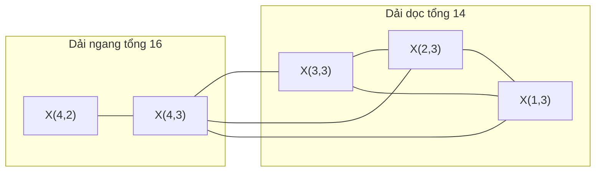
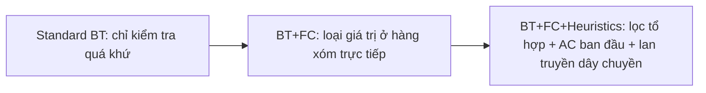
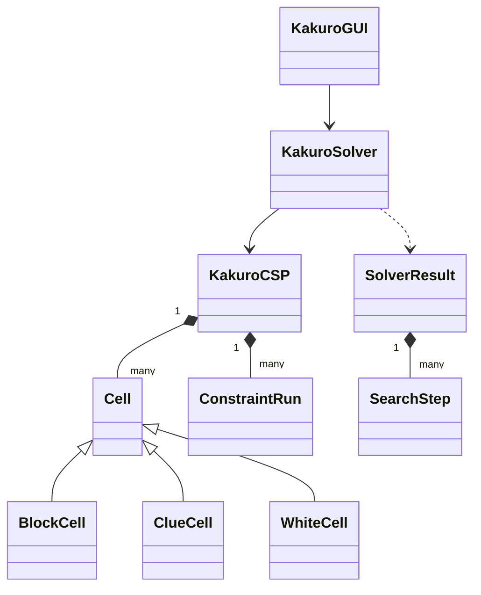

# Cơ Sở Lý Thuyết & Kỹ Thuật Sử Dụng Trong Task 3 — Kakuro CSP Solver

Tài liệu này trình bày **nền tảng lý thuyết** (Constraint Satisfaction Problems — Lecture 08) và **các kỹ thuật cài đặt** được dùng trong thư mục [`task3/`](./). Mỗi khái niệm lý thuyết đều được gắn với đoạn code tương ứng để tiện ôn tập và trả lời vấn đáp.

> [!NOTE]
> Tài liệu này tập trung vào **"tại sao"** (lý thuyết). Phần giải thích **từng dòng code** nằm trong [`EXPLAIN_TASK3.md`].

---

## Mục lục

1. [Bài toán Kakuro](#1-bài-toán-kakuro)
2. [Lý thuyết CSP và cách mô hình hóa Kakuro](#2-lý-thuyết-csp-và-cách-mô-hình-hóa-kakuro)
3. [Tìm kiếm quay lui (Backtracking Search)](#3-tìm-kiếm-quay-lui-backtracking-search)
4. [Kiểm tra tính nhất quán (Consistency Check)](#4-kiểm-tra-tính-nhất-quán-consistency-check)
5. [Lan truyền ràng buộc (Constraint Propagation)](#5-lan-truyền-ràng-buộc-constraint-propagation)
6. [Các heuristic: MRV, Degree, LCV](#6-các-heuristic-mrv-degree-lcv)
7. [Các kỹ thuật cài đặt](#7-các-kỹ-thuật-cài-đặt)
8. [Phát hiện bàn cờ vô nghiệm](#8-phát-hiện-bàn-cờ-vô-nghiệm)
9. [Ví dụ chạy tay trên bàn cờ 5×5](#9-ví-dụ-chạy-tay-trên-bàn-cờ-55)
10. [Phân tích thực nghiệm](#10-phân-tích-thực-nghiệm)
11. [Hạn chế và hướng mở rộng](#11-hạn-chế-và-hướng-mở-rộng)
12. [Tài liệu tham khảo](#12-tài-liệu-tham-khảo)

---

## 1. Bài toán Kakuro

### 1.1. Luật chơi

Kakuro (còn gọi là *Cross Sums*) là một câu đố trên lưới gồm 3 loại ô:

| Loại ô | Mô tả | Lớp trong code |
|---|---|---|
| Ô đen đặc | Không chứa thông tin | [`BlockCell`](kakuro_csp.py) |
| Ô gợi ý (chia chéo) | Chứa tổng của dải ô trắng **bên phải** (tam giác trên-phải) và/hoặc **bên dưới** (tam giác dưới-trái) | [`ClueCell`](kakuro_csp.py) |
| Ô trắng | Cần điền một chữ số | [`WhiteCell`](kakuro_csp.py) |

Người chơi phải điền vào mỗi ô trắng một chữ số từ 1 đến 9 sao cho:

1. **Ràng buộc tổng:** tổng các chữ số trong mỗi dải (run) bằng đúng con số gợi ý.
2. **Ràng buộc khác nhau:** không có chữ số nào lặp lại trong cùng một dải.

### 1.2. Độ phức tạp

- Mỗi ô có 9 lựa chọn, nên với $n$ ô trắng, không gian tìm kiếm "thô" có kích thước $9^n$. Bàn cờ 9×9 của đề có $n = 48$ ô, tức $9^{48} \approx 6.4 \times 10^{45}$ trạng thái. Không thể duyệt hết.
- Bài toán quyết định Kakuro tổng quát đã được chứng minh là **NP-complete** (Takahiro Seta, 2002). Vì vậy không có thuật toán đa thức nào được biết đến. Ta phải dùng **tìm kiếm có cắt tỉa** để giải hiệu quả trong thực tế. Đây chính là lý do mô hình hóa nó thành CSP.

---

## 2. Lý thuyết CSP và cách mô hình hóa Kakuro

### 2.1. Định nghĩa CSP

Một **bài toán thỏa mãn ràng buộc** (CSP) là bộ ba $\mathcal{P} = \langle X, D, C \rangle$:

- $X = \{X_1, \dots, X_n\}$: tập **biến**.
- $D = \{D_1, \dots, D_n\}$: mỗi biến $X_i$ có **miền giá trị** $D_i$.
- $C = \{C_1, \dots, C_m\}$: tập **ràng buộc**. Mỗi ràng buộc $C_j = \langle \text{scope}_j, \text{rel}_j \rangle$ gồm tập biến tham gia (scope) và quan hệ xác định các tổ hợp giá trị được phép.

Một số khái niệm liên quan:

- **Phép gán (assignment):** gán giá trị cho một số biến, ví dụ $\{X_1 = 3, X_5 = 7\}$.
- **Phép gán nhất quán (consistent):** không vi phạm ràng buộc nào.
- **Phép gán đầy đủ (complete):** mọi biến đều đã có giá trị.
- **Nghiệm (solution):** phép gán vừa **đầy đủ** vừa **nhất quán**.

### 2.2. Phân loại ràng buộc

| Loại | Số biến | Ví dụ |
|---|---|---|
| Unary (đơn) | 1 | $X_1 \neq 5$ |
| Binary (nhị phân) | 2 | $X_1 \neq X_2$ |
| N-ary / Global (toàn cục) | $\geq 3$ | $\text{AllDiff}(X_1, \dots, X_k)$, $\sum X_i = S$ |

Ràng buộc của Kakuro là **ràng buộc toàn cục (n-ary)**, vì mỗi dải có thể dài từ 2 đến 9 ô. Có thể tách $\text{AllDiff}$ thành các ràng buộc nhị phân $X_i \neq X_j$, nhưng **ràng buộc tổng thì không tách được** thành các ràng buộc nhị phân. Vì vậy code xử lý trực tiếp cả dải như một đơn vị ([`ConstraintRun`](kakuro_csp.py)).

### 2.3. Mô hình hóa Kakuro thành CSP

| Thành phần | Định nghĩa toán học | Cài đặt |
|---|---|---|
| Biến | $X_{r,c}$ với mỗi ô trắng $(r, c)$ | `KakuroCSP.variables` |
| Miền | $D(X_{r,c}) = \{1, \dots, 9\}$ | `initial_domains` |
| Ràng buộc | Với mỗi dải $R$ có tổng $S$: $\text{AllDiff}(R) \land \sum_{X \in R} X = S$ | `KakuroCSP.runs` (list `ConstraintRun`) |

**Tính chất cấu trúc:** mỗi ô trắng thuộc **đúng một dải ngang và đúng một dải dọc**, nên mỗi biến tham gia đúng 2 ràng buộc (`cell_to_runs[var]` có 2 phần tử). Hai ô khác nhau chia sẻ **tối đa một** dải.

### 2.4. Đồ thị ràng buộc (Constraint Graph)

- **Siêu đồ thị ràng buộc:** mỗi biến là một đỉnh, mỗi dải là một siêu cạnh nối tất cả các ô trong dải.
- **Đồ thị nguyên thủy (primal graph):** hai biến kề nhau nếu cùng thuộc một dải. Code lưu đồ thị này trong `KakuroCSP.neighbors` ([`_build_domains_and_neighbors`](kakuro_csp.py)). Nó được dùng cho **Degree Heuristic**.



---

## 3. Tìm kiếm quay lui (Backtracking Search)

### 3.1. Ý tưởng

Backtracking là **tìm kiếm theo chiều sâu (DFS)** trên cây các phép gán từng phần. Có hai nhận xét quan trọng làm cho nó hiệu quả hơn tìm kiếm thông thường:

1. **Tính giao hoán:** thứ tự gán không ảnh hưởng đến nghiệm. Vì vậy mỗi tầng của cây chỉ cần xét **một biến**, nhờ đó số lá giảm từ $n! \cdot d^n$ xuống còn $d^n$.
2. **Kiểm tra sớm:** ngay khi phép gán từng phần vi phạm ràng buộc, toàn bộ cây con bên dưới bị loại bỏ.

### 3.2. Mã giả (theo AIMA, Chương 6)

```text
function BACKTRACK(assignment, csp):
    if assignment đầy đủ: return assignment
    var ← SELECT-UNASSIGNED-VARIABLE(csp, assignment)          # MRV + Degree
    for each value in ORDER-DOMAIN-VALUES(var, assignment, csp): # LCV
        if value nhất quán với assignment:
            gán var = value
            inferences ← INFERENCE(csp, var, value)              # Forward Checking
            if inferences ≠ failure:
                result ← BACKTRACK(assignment, csp)
                if result ≠ failure: return result
            gỡ var = value và hoàn tác inferences                 # quay lui
    return failure
```

Hàm [`KakuroSolver.solve`](solver.py) cài đặt đúng khung này qua hàm lồng `backtrack()`. Ba "điểm cắm" của khung tương ứng với ba kỹ thuật:

| Điểm cắm | Kỹ thuật | Hàm trong code |
|---|---|---|
| `SELECT-UNASSIGNED-VARIABLE` | MRV + Degree | `select_unassigned_variable` |
| `ORDER-DOMAIN-VALUES` | LCV | `order_domain_values` |
| `INFERENCE` | Forward Checking / lan truyền | `forward_check` |

### 3.3. Tính chất

- **Đầy đủ (complete):** nếu nghiệm tồn tại, thuật toán chắc chắn tìm được, vì nó chỉ loại những nhánh đã được chứng minh là không thể chứa nghiệm.
- **Đúng đắn (sound):** nghiệm trả về luôn thỏa mọi ràng buộc. Code còn kiểm tra lại bằng [`verify_solution`](kakuro_csp.py).
- **Độ phức tạp:** thời gian trường hợp xấu nhất là $O(d^n)$ với $d = 9$. Bộ nhớ là $O(n)$ cho ngăn xếp đệ quy, cộng thêm log hoàn tác.

### 3.4. Ba cấu hình trong code

| Chế độ | Miền khởi tạo | Kiểm tra / Suy luận | Thứ tự biến | Thứ tự giá trị |
|---|---|---|---|---|
| `Standard BT` | $\{1..9\}$ | Chỉ `is_consistent` (nhìn về quá khứ) | Tĩnh (hàng → cột) | Tăng dần 1→9 |
| `BT+FC` | $\{1..9\}$ | `is_consistent` + Forward Checking cơ bản | Tĩnh | Tăng dần |
| `BT+FC+Heuristics` | Đã lọc theo tổ hợp + Arc Consistency | `is_consistent` + lan truyền tổ hợp đầy đủ | MRV + Degree | LCV |

---

## 4. Kiểm tra tính nhất quán (Consistency Check)

Hàm [`is_consistent(var, val, assignment, domains)`](kakuro_csp.py) kiểm tra xem phép gán `var = val` có làm hỏng ràng buộc của hai dải chứa `var` hay không. Đây là kiểm tra **nhìn về quá khứ** (look-back): nó chỉ so với các biến đã gán.

### 4.1. Kiểm tra AllDiff

Nếu `val` đã xuất hiện trong dải thì loại ngay.

### 4.2. Lập luận theo cận (Bounds Reasoning)

Đây là kỹ thuật quan trọng giúp ngay cả `Standard BT` cũng không quá chậm. Giả sử sau khi gán:

- $S_{\text{rem}}$ = tổng mục tiêu trừ đi tổng các ô đã gán,
- $m$ = số ô còn trống trong dải,
- $A$ = các chữ số chưa dùng, sắp xếp tăng dần $a_1 < a_2 < \dots$

Thì $m$ ô còn lại (với các chữ số khác nhau) chỉ có thể đạt tổng trong khoảng:

$$\text{min} = \sum_{i=1}^{m} a_i \qquad \text{max} = \sum_{i=|A|-m+1}^{|A|} a_i$$

Nếu $S_{\text{rem}} \notin [\text{min}, \text{max}]$ thì **chắc chắn không thể hoàn thành dải**, nên loại `val`.

> **Ví dụ:** dải 4 ô tổng 11, đã gán ô đầu bằng 5. Còn $m=3$ ô, $S_{\text{rem}} = 6$, $A = \{1,2,3,4,6,7,8,9\}$. Ta có $\text{min} = 1+2+3 = 6$, nên $6 \in [6, 24]$ và vẫn hợp lệ. Nếu ô đầu là 6 thì $S_{\text{rem}} = 5 < \text{min} = 1+2+3 = 6$, nên bị loại ngay.

### 4.3. Kiểm tra hỗ trợ tổ hợp (chỉ trong chế độ có FC)

Phải tồn tại ít nhất một tổ hợp hợp lệ $T$ của dải sao cho $T$ chứa mọi giá trị đã gán, và mỗi ô trống còn ít nhất một ứng viên trong $T \setminus \text{đã gán}$.

---

## 5. Lan truyền ràng buộc (Constraint Propagation)

### 5.1. Khái niệm tính nhất quán cục bộ

**Lan truyền ràng buộc** là dùng các ràng buộc để **thu hẹp miền giá trị** trước hoặc trong khi tìm kiếm. Các mức nhất quán cục bộ, từ yếu đến mạnh:

| Mức | Định nghĩa |
|---|---|
| **Node consistency** | Mọi giá trị trong $D_i$ thỏa các ràng buộc đơn của $X_i$. |
| **Arc consistency (AC)** | Với ràng buộc nhị phân $(X_i, X_j)$: mọi $v \in D_i$ có ít nhất một $w \in D_j$ "hỗ trợ" nó. |
| **Generalized Arc Consistency (GAC)** | Mở rộng AC cho ràng buộc n-ary: mọi $v \in D_i$ phải nằm trong ít nhất một bộ giá trị thỏa ràng buộc, với các biến còn lại lấy từ miền của chúng. |

**Forward Checking (FC)** là dạng suy luận nhẹ: sau khi gán $X = v$, chỉ loại các giá trị mâu thuẫn **trong miền của các biến kề với $X$**. FC không lan truyền tiếp.

**AC-3** (Mackworth, 1977) dùng một **hàng đợi các cung**. Khi miền của một biến bị thu hẹp, mọi cung trỏ đến biến đó được đưa lại vào hàng đợi, cho đến khi không còn thay đổi nào.

### 5.2. Kỹ thuật 1 — Lọc theo tổ hợp tổng (tiền xử lý)

**Lý thuyết:** với dải độ dài $k$ và tổng $S$, tập các tổ hợp hợp lệ là

$$\mathcal{T}(k, S) = \{ T \subseteq \{1..9\} : |T| = k, \textstyle\sum T = S \}$$

Một chữ số $d$ chỉ có thể xuất hiện trong dải nếu $d \in \bigcup \mathcal{T}(k,S)$. Vì mỗi ô thuộc 2 dải nên:

$$D(X_{r,c}) \leftarrow \text{Allowed}(R_{\text{ngang}}) \cap \text{Allowed}(R_{\text{dọc}})$$

**Code:** [`ConstraintRun.valid_combinations`](kakuro_csp.py) dùng `itertools.combinations` để sinh trước mọi tổ hợp, rồi `allowed_digits()` lấy hợp của chúng. Phép giao nằm trong `_build_domains_and_neighbors` (lưu vào `pruned_domains`).

**Chi phí:** số tổ hợp tối đa của một dải là $\binom{9}{4} = \binom{9}{5} = 126$. Tổng số tập con của $\{1..9\}$ chỉ là $2^9 - 1 = 511$, nên bước tiền xử lý gần như tức thời.

**Các tổ hợp "duy nhất" kinh điển** (rất hay bị hỏi khi vấn đáp):

| Độ dài | Tổng | Tổ hợp duy nhất |
|---|---|---|
| 2 | 3 | {1, 2} |
| 2 | 4 | {1, 3} |
| 2 | 16 | {7, 9} |
| 2 | 17 | {8, 9} |
| 3 | 6 | {1, 2, 3} |
| 3 | 24 | {7, 8, 9} |
| 4 | 10 | {1, 2, 3, 4} |
| 4 | 11 | {1, 2, 3, 5} |
| 4 | 30 | {6, 7, 8, 9} |
| 9 | 45 | {1, …, 9} |

### 5.3. Kỹ thuật 2 — Arc Consistency ban đầu

[`initial_arc_consistency`](solver.py) chạy trước khi tìm kiếm, **chỉ trong chế độ `BT+FC+Heuristics`**. Với mỗi dải:

1. Xác định các ô **đơn trị** (miền chỉ còn 1 giá trị). Nếu hai ô đơn trị trùng giá trị thì bỏ qua (mâu thuẫn sẽ được phát hiện khi tìm kiếm).
2. Giữ lại các tổ hợp $T$ chứa mọi giá trị đơn trị **và** giao khác rỗng với miền của mọi ô trong dải.
3. Loại khỏi miền của mỗi ô những giá trị không thuộc hợp các tổ hợp được giữ lại. Riêng ô không đơn trị còn bị loại thêm các giá trị mà ô đơn trị đã "chiếm".

Thuật toán lặp tối đa 2 vòng qua tất cả các dải, hoặc dừng sớm nếu không còn thay đổi.

> [!NOTE]
> Đây là một **xấp xỉ của GAC**, không phải GAC đầy đủ. GAC thật cần kiểm tra xem có tồn tại cách gán các chữ số **khác nhau** cho từng ô (một bài toán ghép cặp), trong khi code chỉ kiểm tra mỗi ô "có ít nhất một ứng viên" trong tổ hợp. Đổi lại, cách này rẻ và vẫn **đúng đắn** (không bao giờ xóa nhầm giá trị thuộc nghiệm).

### 5.4. Kỹ thuật 3 — Forward Checking cơ bản (chế độ `BT+FC`)

Trong [`forward_check(..., full_propagation=False)`](solver.py), sau khi gán `var = val`, với mỗi ô trống `u` thuộc 2 dải của `var`, code xóa giá trị `d` nếu:

- `d` đã được dùng trong dải (AllDiff),
- `u` là ô trống cuối cùng nhưng `d` khác tổng còn thiếu,
- hoặc `d` cộng với tổng nhỏ nhất/lớn nhất có thể của các ô trống khác không chạm được $S_{\text{rem}}$ (lập luận cận, mục 4.2).

Nếu miền của bất kỳ ô nào trở thành rỗng thì trả về `False`, và thuật toán quay lui **ngay** mà không cần đi sâu hơn. Đây là ưu điểm cốt lõi của FC: **phát hiện ngõ cụt sớm**.

### 5.5. Kỹ thuật 4 — Lan truyền tổ hợp kiểu AC-3 (chế độ `BT+FC+Heuristics`)

Trong [`forward_check(..., full_propagation=True)`](solver.py), code mạnh hơn FC thông thường, vì nó là sự kết hợp giữa **FC và AC-3 trên các dải**:

```text
queue ← 2 dải chứa var
while queue khác rỗng:
    run ← queue.pop()
    required ← {giá trị đã gán} ∪ {giá trị của các ô đơn trị}     # nếu trùng nhau → thất bại
    supported ← ∪ (T \ required)  với mọi tổ hợp T ⊇ required
                                  mà mọi ô chưa đơn trị đều còn ứng viên trong T \ required
    với mỗi ô u chưa đơn trị trong run:
        xóa khỏi D(u) các giá trị ∈ required hoặc ∉ supported
        nếu D(u) = ∅ → thất bại
        nếu D(u) bị thu hẹp → đưa dải còn lại của u vào queue     # lan truyền dây chuyền
```

**Điểm khác với FC:** khi miền của `u` bị thu hẹp, **dải vuông góc** đi qua `u` được đưa vào hàng đợi. Nhờ đó ảnh hưởng của một phép gán có thể lan ra xa hơn các hàng xóm trực tiếp. Đây đúng là tinh thần của AC-3.

**Chứng minh ngắn tính đúng đắn (không xóa nhầm):** giả sử tồn tại nghiệm mở rộng được phép gán hiện tại. Gọi $T^*$ là tập giá trị của dải trong nghiệm đó. Khi đó:

- $T^* \in \mathcal{T}(k,S)$ và $T^*$ chứa mọi giá trị đã gán. Nó cũng chứa mọi giá trị đơn trị, vì ô đơn trị bắt buộc phải nhận giá trị đó.
- Mỗi ô chưa đơn trị nhận trong nghiệm một giá trị thuộc $T^* \setminus \text{required}$ và thuộc miền của nó.

Vậy $T^*$ vượt qua phép lọc, và giá trị của mỗi ô trong nghiệm thuộc `supported`, nên không bị xóa. ∎

### 5.6. So sánh sức mạnh



Suy luận càng mạnh thì **mỗi nút tốn nhiều thời gian hơn**, nhưng **số nút phải duyệt ít hơn rất nhiều**. Với Kakuro, sự đánh đổi này luôn có lợi khi bàn cờ đủ khó.

---

## 6. Các heuristic: MRV, Degree, LCV

Thứ tự chọn biến và giá trị **không ảnh hưởng đến tính đúng**, nhưng ảnh hưởng **rất lớn đến kích thước cây tìm kiếm**.

### 6.1. MRV — Minimum Remaining Values

**Quy tắc:** chọn biến chưa gán có $|D(X)|$ nhỏ nhất.

**Lý thuyết — nguyên lý "Fail-First":**

- Nếu $|D(X)| = 0$, ta phát hiện thất bại ngay lập tức.
- Nếu $|D(X)| = 1$, việc gán là **bắt buộc**, không phải phân nhánh (hệ số nhánh bằng 1).
- Nói chung, chọn biến có hệ số nhánh nhỏ ở gần gốc cây sẽ làm cây hẹp hơn. Nếu nhánh hiện tại đã sai, biến "khó" nhất sẽ lộ ra mâu thuẫn sớm nhất, giúp cắt tỉa được một cây con lớn.

### 6.2. Degree Heuristic

**Quy tắc:** khi nhiều biến hòa nhau về MRV, chọn biến có **nhiều hàng xóm chưa gán nhất**.

**Lý thuyết:** biến có bậc cao tác động lên nhiều biến khác. Gán nó trước sẽ giúp FC thu hẹp miền của nhiều biến nhất, làm cho các lần chọn MRV sau chính xác hơn. Heuristic này đặc biệt hữu ích **ở bước đầu**, khi hầu hết các miền còn bằng nhau.

**Code** ([`select_unassigned_variable`](solver.py)):

```python
key = (len(domains[var]),              # 1) MRV: miền nhỏ nhất
       -degree,                         # 2) Degree: bậc lớn nhất (đổi dấu vì dùng min)
       var)                             # 3) Tọa độ: đảm bảo kết quả tất định
```

### 6.3. LCV — Least Constraining Value

**Quy tắc:** sau khi đã chọn biến, thử trước giá trị **loại ít ứng viên của hàng xóm nhất**.

**Lý thuyết — nguyên lý "Succeed-First":** ta chỉ cần **một** nghiệm. Vì vậy nên ưu tiên giá trị giữ được nhiều lựa chọn nhất cho phần còn lại của bài toán, để tăng xác suất nhánh đầu tiên dẫn tới nghiệm.

> [!TIP]
> **Câu hỏi hay gặp:** "Tại sao chọn biến thì *fail-first* mà chọn giá trị lại *succeed-first*?"
> Vì **mọi biến cuối cùng đều phải được gán**: gặp khó khăn sớm thì tốt, vì cắt tỉa được nhiều. Còn với giá trị, ta **chỉ cần một giá trị đúng**: chọn giá trị có nhiều khả năng đúng nhất để khỏi phải quay lui.

**Code** ([`order_domain_values`](solver.py)): với mỗi giá trị ứng viên `val`, hàm `lcv_cost(val)` đếm tổng số giá trị trong miền của các hàng xóm chưa gán sẽ bị loại. Một giá trị `d` bị coi là loại nếu `d == val` hoặc `d` không còn nằm trong tổ hợp hợp lệ nào của dải. Sau đó các giá trị được sắp xếp tăng dần theo chi phí này.

---

## 7. Các kỹ thuật cài đặt

### 7.1. Hoàn tác bằng nhật ký (Trail-based Undo)

Khi quay lui, miền giá trị phải được khôi phục về **đúng trạng thái trước phép gán**. Có hai cách:

| Cách | Chi phí mỗi nút | Ghi chú |
|---|---|---|
| Sao chép toàn bộ `domains` (`deepcopy`) | $O(n \cdot d)$ | Đơn giản nhưng tốn bộ nhớ và chậm |
| **Ghi nhật ký các giá trị bị xóa** (`pruned_log`) | $O(\text{số giá trị bị xóa})$ | Code đang dùng cách này |

```python
for cell_pos, removed_val in pruned_log:   # khôi phục chính xác những gì đã xóa
    domains[cell_pos].add(removed_val)
del assignment[var]
domains[var] = saved_var_domain
```

Đây là kỹ thuật **trail** kinh điển trong các bộ giải ràng buộc (constraint solvers).

### 7.2. Tính trước (Precomputation)

Các tổ hợp hợp lệ của mỗi dải được tính **một lần duy nhất** lúc khởi tạo `ConstraintRun`. Nhờ vậy mọi bước lan truyền và LCV về sau chỉ cần duyệt danh sách có sẵn, không phải sinh lại.

### 7.3. Ghi lại các bước để trực quan hóa (Event Recording)

Mỗi sự kiện quan trọng (`INITIAL`, `PRUNE`, `ASSIGN`, `PROPAGATE`, `BACKTRACK`, `SOLVED`, `UNSOLVABLE`) được lưu thành một đối tượng [`SearchStep`](solver.py) chứa **ảnh chụp (snapshot)** của `assignment` và `domains`.

- Giao diện chỉ cần "phát lại" danh sách này, nên có thể tua tới/lui từng bước mà không phải chạy lại solver.
- Số bước được giới hạn ở 5000 để tránh tốn bộ nhớ khi chạy `Standard BT` trên bàn cờ lớn.
- Khi chạy benchmark, `record_steps=False` để việc chụp ảnh không làm sai lệch thời gian đo.

### 7.4. Giới hạn tìm kiếm

Tham số `max_assignments` (mặc định 200,000) ngăn chương trình bị treo trên bàn cờ quá khó.

### 7.5. Thiết kế hướng đối tượng



Mỗi lớp có một trách nhiệm rõ ràng:

- `KakuroCSP` **mô tả bài toán**.
- `KakuroSolver` **giải** bài toán.
- `KakuroGUI` **hiển thị** kết quả.

Nhờ tách như vậy, có thể thay solver mà không phải sửa GUI, và ngược lại.

---

## 8. Phát hiện bàn cờ vô nghiệm

Vì backtracking là **đầy đủ**, nếu hàm `backtrack()` gốc trả về `False` (và không bị chặn bởi `max_assignments`) thì đó là **chứng minh** rằng không có nghiệm nào. Khi đó code ghi thêm bước `UNSOLVABLE`, và giao diện tô đỏ toàn bộ bàn cờ.

Bàn cờ [`4_unsolvable_5x5.txt`](puzzles/4_unsolvable_5x5.txt) được thiết kế có **tổng các gợi ý hàng bằng tổng các gợi ý cột** ($15+20+11+14 = 13+22+14+11 = 60$), nên phép kiểm tra tổng thô không phát hiện được lỗi. Mâu thuẫn chỉ lộ ra khi các dải giao nhau. Kết quả:

| Cấu hình | Số phép gán trước khi kết luận vô nghiệm |
|---|---:|
| `Standard BT` | 1,320 |
| `BT+FC` | 621 |
| `BT+FC+Heuristics` | **3** |

Điều này cho thấy lan truyền ràng buộc mạnh không chỉ giúp **tìm nghiệm nhanh** mà còn giúp **chứng minh vô nghiệm nhanh**.

---

## 9. Ví dụ chạy tay trên bàn cờ 5×5

Bàn cờ [`1_example_5x5.txt`](puzzles/1_example_5x5.txt) (trang 4 đề bài):

```text
 #      #      21\    14\    #
 #      14\12  _      _      11\
 \21    _      _      _      _
 \11    _      _      _      _
 #      \16    _      _      #
```

### Bước 1 — Xác định 8 dải và các chữ số cho phép

| Dải | Ô | $k$ | $S$ | Chữ số cho phép |
|---|---|---|---|---|
| Ngang hàng 1 | (1,2),(1,3) | 2 | 12 | {3,4,5,7,8,9} |
| Ngang hàng 2 | (2,1)…(2,4) | 4 | 21 | {1..9} |
| Ngang hàng 3 | (3,1)…(3,4) | 4 | 11 | **{1,2,3,5}** (tổ hợp duy nhất) |
| Ngang hàng 4 | (4,2),(4,3) | 2 | 16 | **{7,9}** (tổ hợp duy nhất) |
| Dọc cột 2 | (1,2)…(4,2) | 4 | 21 | {1..9} |
| Dọc cột 3 | (1,3)…(4,3) | 4 | 14 | {1..8} (vì $9 + 1 + 2 + 3 = 15 > 14$) |
| Dọc cột 1 | (2,1),(3,1) | 2 | 14 | {5,6,8,9} |
| Dọc cột 4 | (2,4),(3,4) | 2 | 11 | {2..9} |

### Bước 2 — Giao miền (lọc theo tổ hợp)

| Ô | Miền sau khi giao | Ghi chú |
|---|---|---|
| (1,2) | {3,4,5,7,8,9} | |
| (1,3) | {3,4,5,7,8} | |
| (2,1) | {5,6,8,9} | |
| (2,2) | {1..9} | |
| (2,3) | {1..8} | |
| (2,4) | {2..9} | |
| **(3,1)** | {1,2,3,5} ∩ {5,6,8,9} = **{5}** | Đơn trị! |
| (3,2) | {1,2,3,5} | |
| (3,3) | {1,2,3,5} | |
| (3,4) | {2,3,5} | |
| (4,2) | {7,9} | |
| **(4,3)** | {7,9} ∩ {1..8} = **{7}** | Đơn trị! |

Chỉ riêng bước tiền xử lý đã loại **53** ứng viên. Hai ô (3,1) = 5 và (4,3) = 7 được xác định mà **chưa cần tìm kiếm**.

### Bước 3 — Lan truyền và MRV

- Từ (3,1) = 5 và dải dọc cột 1 tổng 14, suy ra (2,1) = 9.
- Từ (4,3) = 7 và dải hàng 4 tổng 16, suy ra (4,2) = 9.
- Hàng 3 còn lại 3 ô với tổng 11 − 5 = 6, tức tổ hợp {1,2,3}. Do đó (3,4) chỉ còn {2,3}.
- MRV luôn chọn ô có miền nhỏ nhất. Vì vậy thuật toán đi gần như **thẳng** tới nghiệm.

### Kết quả

Chế độ `BT+FC+Heuristics` giải xong với **12 phép gán cho 12 ô, 0 lần quay lui**:

```text
 #    #   21\  14\   #
 #  14\12  8    4   11\
\21   9    3    1    8
\11   5    1    2    3
 #   \16   9    7    #
```

---

## 10. Phân tích thực nghiệm

Kết quả chạy `python task3\benchmark.py`:

| Bàn cờ | $n$ | Cấu hình | Giải được | Số phép gán | Số lần quay lui | Giá trị bị cắt | Thời gian (ms) |
|---|---:|---|:---:|---:|---:|---:|---:|
| 5×5 (trang 4) | 12 | Standard BT | Có | 1,109 | 1,097 | 0 | ~18.9 |
| | | BT+FC | Có | 541 | 529 | 4,449 | ~12.1 |
| | | **BT+FC+Heuristics** | Có | **12** | **0** | 95 | **~0.5** |
| 9×9 (trang 5) | 48 | Standard BT | Có | 1,036 | 988 | 0 | ~19.1 |
| | | BT+FC | Có | 153 | 105 | 919 | ~4.1 |
| | | **BT+FC+Heuristics** | Có | **59** | **11** | 491 | ~4.8 |
| 8×6 (mở rộng) | 29 | Standard BT | Có | 174 | 145 | 0 | ~2.9 |
| | | BT+FC | Có | 63 | 34 | 345 | ~1.6 |
| | | **BT+FC+Heuristics** | Có | **31** | **2** | 272 | ~1.9 |
| 5×5 vô nghiệm | 12 | Standard BT | Không | 1,320 | 1,320 | 0 | ~20.6 |
| | | BT+FC | Không | 621 | 621 | 4,859 | ~13.7 |
| | | **BT+FC+Heuristics** | Không | **3** | **3** | 80 | **~0.3** |

> Thời gian đo có thể dao động nhẹ giữa các lần chạy. Số phép gán và số lần quay lui thì tất định.

### Nhận xét

1. **Số phép gán** là thước đo chính của kích thước cây tìm kiếm. Cấu hình đầy đủ giảm số phép gán **94–99%** so với `Standard BT`.
2. **Đánh đổi thời gian trên mỗi nút:** trên bàn 9×9 và 8×6, `BT+FC+Heuristics` duyệt ít nút hơn hẳn nhưng thời gian **tương đương** `BT+FC`. Lý do là mỗi nút tốn thêm chi phí tính LCV và lan truyền tổ hợp. Với bàn cờ lớn và khó hơn, lợi ích của việc cắt tỉa sẽ vượt trội.
3. **Vì sao `BT+FC` vẫn tốn 541 phép gán trên bàn 5×5?** Chế độ này bắt đầu với miền $\{1..9\}$ đầy đủ, chỉ dùng lập luận cận, và chọn biến theo thứ tự tĩnh. Do đó nó thử nhiều giá trị ở hàng 1–2 trước khi chạm tới ràng buộc chặt ở hàng 3–4 (tổng 11 và 16). Điều này minh họa rằng **thứ tự biến (MRV) quan trọng không kém suy luận**.
4. **"Giá trị bị cắt"** của `BT+FC` lớn hơn của cấu hình đầy đủ vì nó cắt lặp đi lặp lại trên rất nhiều nhánh sai, chứ không phải vì nó cắt hiệu quả hơn.

---

## 11. Hạn chế và hướng mở rộng

| Hạn chế hiện tại | Hướng cải tiến |
|---|---|
| AC ban đầu và lan truyền chỉ là **xấp xỉ GAC** | Cài GAC đầy đủ cho AllDiff bằng thuật toán ghép cặp (Régin, 1994) kết hợp ràng buộc tổng |
| Quay lui theo thứ tự thời gian (chronological) | **Conflict-Directed Backjumping**: nhảy thẳng về biến gây xung đột |
| Lưu miền bằng `set` của Python | Dùng **bitmask 9 bit** để giao/hợp trong $O(1)$ |
| LCV tính lại từ đầu ở mỗi nút | Cache kết quả, hoặc chỉ dùng LCV khi miền có từ 3 giá trị trở lên |
| Lan truyền chỉ chạy sau phép gán | **MAC (Maintaining Arc Consistency)**: chạy AC đầy đủ sau mỗi phép gán |

---

## 12. Tài liệu tham khảo

1. S. Russell and P. Norvig, *Artificial Intelligence: A Modern Approach*, 4th ed., Pearson, 2020, Chapter 6: "Constraint Satisfaction Problems".
2. A. K. Mackworth, "Consistency in networks of relations," *Artificial Intelligence*, vol. 8, no. 1, pp. 99–118, 1977. (Thuật toán AC-3)
3. R. M. Haralick and G. L. Elliott, "Increasing tree search efficiency for constraint satisfaction problems," *Artificial Intelligence*, vol. 14, no. 3, pp. 263–313, 1980. (Forward Checking, nguyên lý fail-first)
4. J.-C. Régin, "A filtering algorithm for constraints of difference in CSPs," in *Proc. AAAI*, 1994. (GAC cho AllDifferent)
5. T. Seta, "The complexities of puzzles, cross sum and their another solution problems (ASP)," Senior thesis, University of Tokyo, 2002. (Kakuro là NP-complete)
6. Slide bài giảng Lecture 08 — Constraint Satisfaction Problems, môn Nhập môn Trí tuệ Nhân tạo, ĐH Tôn Đức Thắng.
